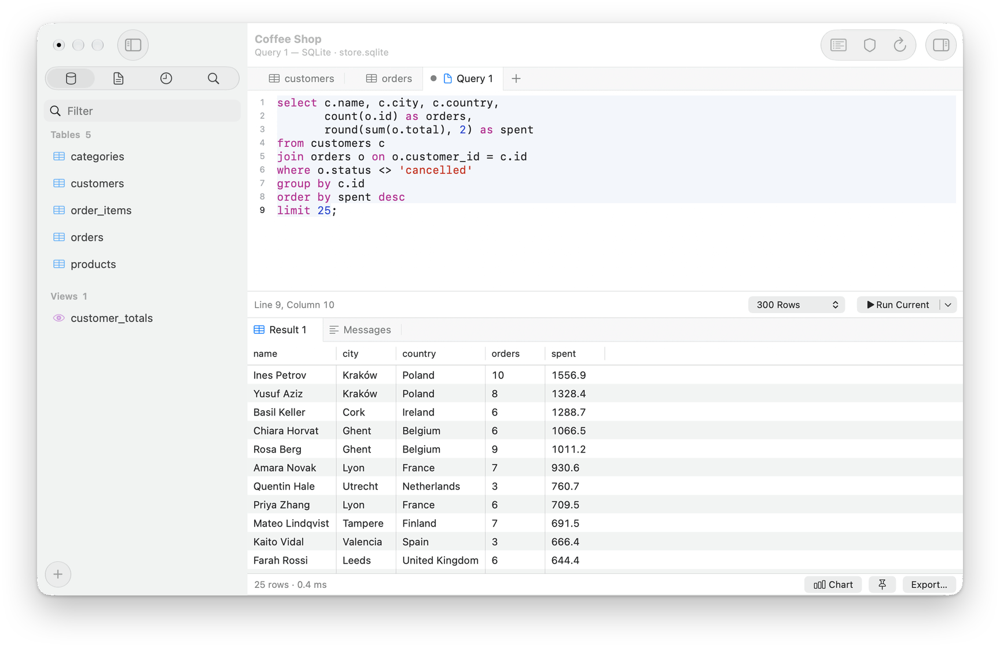

<p align="center">
  
</p>

<h1 align="center">Moonrow</h1>

<p align="center">
  A native Mac app for SQLite, PostgreSQL, MySQL and MariaDB.
  <br>
  <a href="https://github.com/raf-a/moonrow/releases/latest">Download</a>
  ·
  <a href="#build-from-source">Build from source</a>
</p>

<picture>
  <source media="(prefers-color-scheme: dark)" srcset="docs/images/readme-dark.png">
  
</picture>

## Features

- **Staged edits:** changes to rows and structure wait until you commit them, and you can read the SQL first.
- **Saved queries as files:** each connection’s queries are `.sql` files in a folder, ready for any editor or version control.
- **SSH tunnels** through your Mac’s own OpenSSH, so your `~/.ssh/config` and keys work as they do in Terminal.
- **Safe mode:** a connection can ask for confirmation or its password before it sends changes.
- **Import, export and backup:** CSV, JSON, SQL and Excel, and backups with `pg_dump` and `mysqldump`.

## Install

Download the [latest release](https://github.com/raf-a/moonrow/releases/latest). Moonrow needs macOS 14 or later, and updates itself.

## Build from source

With Xcode 26 or later:

```bash
swift build
scripts/build-app.sh
```

## Contributing

To report a bug or ask for a feature, [open an issue](https://github.com/raf-a/moonrow/issues). For a bug, say which database and version you use, the steps that cause it, and what you expected to happen.

Pull requests are welcome. For a larger change, open an issue first so we can agree on the approach.

## Licence

[MIT](LICENSE)
